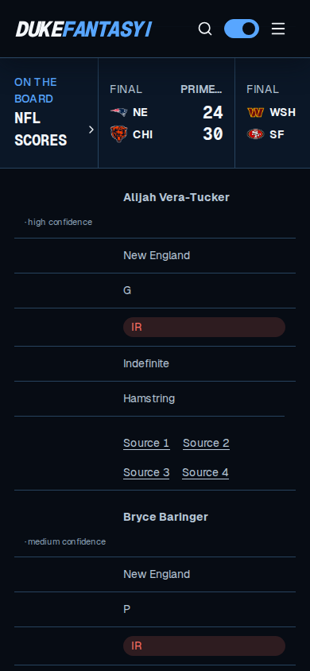
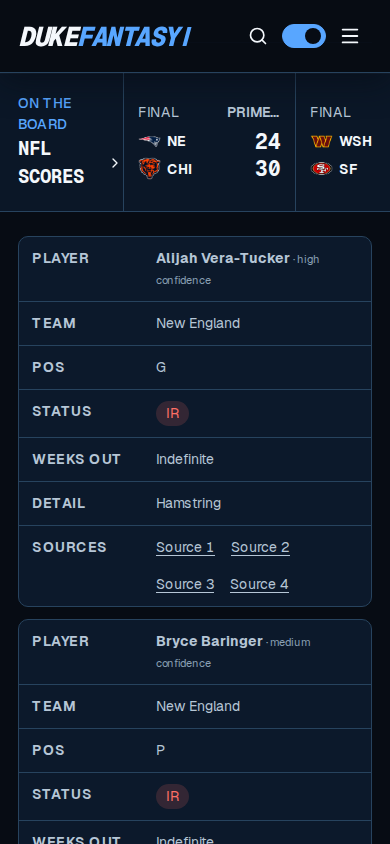
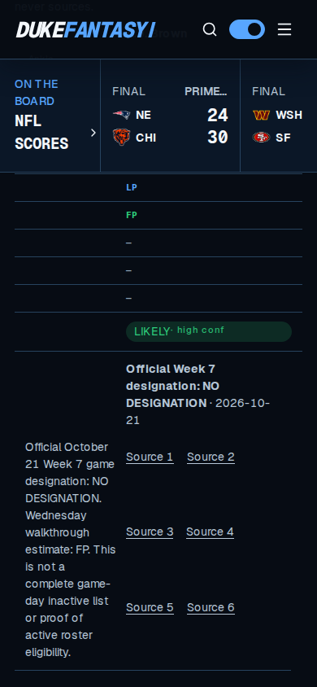
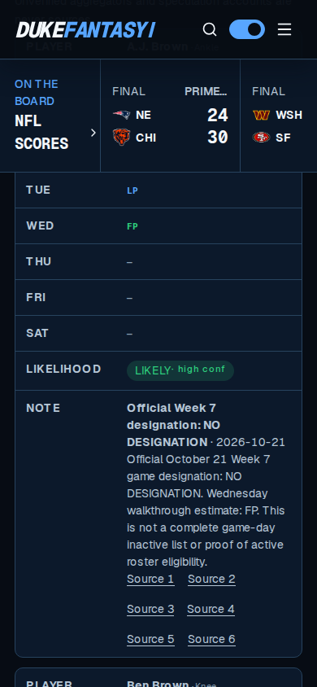

# Injury-table mobile presentation correction

Historical October 23 evidence. See [the October 26 review](PR44_REVIEW_2026-10-26.md) for the current merged-main candidate, corrections and completed release/WebKit checks.

Acceptance: **PASS WITH CONDITIONS for the corrective source PR. Release acceptance remains blocked.**

Mission: repair both injury tables below 680 CSS pixels while preserving published facts, evidence, source dates and the Week 7 publication path. Inputs reviewed: current `main` at `98ceeb55037a3c6289c86df40b62dada8f83e246`, PRs #40–#43, `components/injury-report-page.tsx`, `app/data-boards.css`, `AGENTS.md`, the accessibility standard and Week 7 runbook. The earlier calendar-date worktree was preserved; this correction uses a separate worktree and branch.

## Change and assumptions

Reuse the existing 679px mobile breakpoint, `db-data-row` card styles and generated `data-label` field labels. Give every cell its correct label and explicit `headers` reference to a stable, scoped column ID. Keep native headings in the document, named semantic tables and source order; explicit table roles retain semantics when CSS changes display. Named, focusable wrappers support keyboard scrolling at intermediate desktop widths.

| Structure | Column order retained |
| --- | --- |
| Long-term ledger | Player, Team, Pos, Status, Weeks out, Detail, Sources |
| Week-to-week watch | Player, Team, Pos, Mon, Tue, Wed, Thu, Fri, Sat, Likelihood, Note |

Each cell has one `inj-cell-value` wrapper. This prevents the mobile two-column grid from scattering player/confidence text or a designation, note and source links into separate grid tracks. Values wrap, including likelihood pills. Keep confidence text fully opaque: axe found that its previous opacity produced 4.25:1 contrast on mobile cards. A 320px page-level test also found the shared header extending to 333px; a wordmark/gap adjustment only below 360px fixes that overflow without hiding navigation controls.

No player values, classifications, availability conclusions, practice reports, reserve listings, inactive lists, dates, source URLs, evidence files or publication scripts change. The complete `data/` tree, generated dataset, injury/content adapters, Worker deployment configuration and Week 7 release scripts match the base. All previously locked dependency versions and production dependency pins remain unchanged; only Playwright/axe development dependencies are added.

## Verification

| Check | Result |
| --- | --- |
| `npm run verify` | PASS: typecheck, lint, 147 unit tests, build, nine rendered tests, existing accessibility/SEO/link checks, 17 visual-artifact checks, migration and dataset seed |
| New server-rendered table regression | PASS: all cells have correct labels, column references, row structures and grouped values before hydration |
| `npm run test:injuries -- --project 'chromium-*'` | PASS: 25 cases at 320, 390, 679, 680 and 1440px, including five capture cases |
| Narrow layouts | PASS: every published cell checked for visible generated labels, complete values, wrapping and bounds; document width stays within each viewport |
| Keyboard/filter/source behavior | PASS: native Home/End/Arrow/Enter team selection, all 13 New England ledger rows and nine watch rows, restoring all 405 players, exact source URLs and safe target/rel values, Tab/Shift+Tab link order, visible focus, and keyboard horizontal scrolling when needed |
| Accessibility | PASS in Chromium: named tables, retained column headers and cell order; native accessibility tree exposes 14 ledger rows/7 columns/91 data cells and 10 watch rows/11 columns/99 data cells after filtering; zero axe violations in the two filtered tables and team control at all five widths |
| `npm run dataset:verify` | PASS: 272 events, 94 finals, all 32 standings rows; zero changed kickoff instants |
| `npm audit --omit=dev --fetch-retries=0 --fetch-timeout=20000` | PASS: zero vulnerabilities |
| `npm run cf:types` | PASS |
| `wrangler deploy --config wrangler.deploy.jsonc --dry-run` | PASS; no upload or production deployment |
| `npm run week7:preflight` | BLOCKED by the unchanged evidence gate: `schedule: missing, future or stale retrieval time` |
| `npm run test:injuries -- --project webkit-390` | BLOCKED before assertions: missing Linux WebKit libraries. Browser download succeeded; dependency installation failed because the sandbox cannot switch apt users/groups. No WebKit pass is claimed. |

The initial 390px baseline run against the unchanged production build failed four label/layout/named-table cases; its capture case passed. The screenshots show unlabeled fields and scattered watch-note contents before the correction. Baseline filtering itself worked; the source-link regression could not locate the newly required named tables. The corrected run passes all 25 Chromium cases. Machine-readable counts, preservation checks and screenshot hashes are in [summary.json](verification/injury-mobile-2026-10-23/summary.json).

This environment used Playwright 1.64.1 with Chromium 153.0.8010.0 from a temporary external test runtime. Chromium's normal download returned an empty archive. An executable override supplied the test browser; no application browser dependency or runtime setting was changed. A temporary loopback-only interface-enumeration shim outside the repository allowed Wrangler to launch in this sandbox. Playwright starts Wrangler as a child, keeping the local server and test browser in the same isolated network namespace.

No manual NVDA/VoiceOver speech session was available. Native Chromium accessibility-tree checks and axe are the automated evidence; WebKit and manual speech behavior remain unverified.

## Before and after at 390px

The same published New England rows are shown. The watch viewport is centered on a tall row, so the sticky site shell overlays its upper fields; the screenshot exposes the practice labels, likelihood, designation, note and sources. All eleven fields are covered by the automated assertions.

| Table | Before | After |
| --- | --- | --- |
| Ledger |  |  |
| Watch |  |  |

## Reproduction and handoff

Deliverables: `components/injury-report-page.tsx`, scoped injury styles in `app/data-boards.css`, the sub-360px header correction in `app/broadcast.css`, `tests/rendered-html.test.mjs`, `tests/browser/injuries.spec.ts`, `playwright.injuries.config.ts`, the `test:injuries` npm script/dev dependencies, this report and `docs/verification/injury-mobile-2026-10-23/`. The decision, assumptions and traceability registers reference this correction.

On a supported host:

```sh
npm ci
npx playwright install --with-deps chromium webkit
npm run verify
npm run test:injuries
npm run week7:preflight
```

The dedicated browser script uses the already built Worker, launches only local Wrangler and stores results under ignored `outputs/injury-mobile/`. Existing publication command sequences and evidence validation are unchanged.

Next owner: the repository/release operator. Review the corrective head, complete WebKit and assistive-technology verification on a supported host, and obtain the established merge/deployment authorization. Before a production release, obtain actual fresh two-source research through the established serialized Week 7 process and pass the complete preflight and exact-revision public smoke checks. Do not change source timestamps merely to satisfy the gate. No merge, auto-merge or production deployment is performed by this task.
