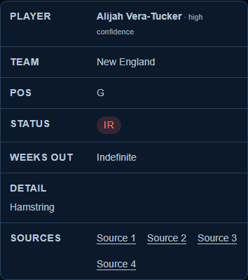
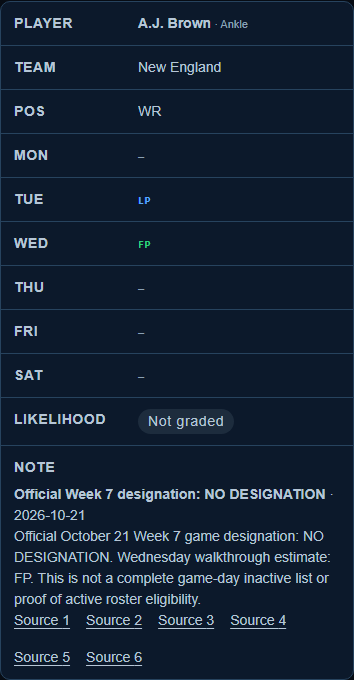

# PR 44 release review — October 26, 2026

Acceptance: **PASS for the reviewed release candidate.** Merge and production publication remain with the owner. The [October 23 report](INJURY_MOBILE_VERIFICATION_2026-10-23.md) is historical; this review supersedes its stale-evidence and unavailable-WebKit conditions.

## Mission, inputs and assumptions

Resolve PR 44 against current main at `7e259cf5ef0115c91bc850be828b4fb4a625c968`, address the existing review, and verify the resulting release candidate. Inputs were the original PR head, Copilot review, current AGENTS.md/runbook, component/CSS/test changes, live NFL/ESPN sources and the existing publication evidence. Keep the latest medical, practice, inactive, reserve and fantasy records. A code review does not renew their source dates.

## Changes and decisions

- Merge current main into the existing branch without discarding the newer mobile note layout, results, inactive history or clinical changes.
- Give the two inner scroll regions distinct names, retaining the parent headings and named tables. Verify unique landmarks, every cell label/header relationship and grouped value, visible focus, wrapping and keyboard behavior.
- Preserve all 465 existing lockfile package records exactly, including 42 libc records. Add only the five Playwright/axe development packages and their root dependency entries.
- Start local Wrangler through the current Node executable, so browser tests do not depend on a globally available npx command.
- Perform an actual complete two-publisher review of all 107 result facts through Week 7: 106 season finals, 13 Week 7 finals and 32 matching standings. Retain all 272 games and international metadata.
- The mandatory live comparison caught one newly moved future fixture. NFL and ESPN both confirm Raiders–49ers on November 8 at **4:25 PM Eastern on FOX**, replacing 4:05 PM/CBS. Correct only that fixture's instant, display labels and network. The [two-source evidence](../data/content-refresh/research-runs/2026-10-26T210800Z/future-schedule-correction.json) records the matched weekly NFL Game Card and ESPN event 401873047, resolved URLs, actual retrieval times and capture hashes.

Schedule sourceAsOf is October 26 because of actual re-verification and the corroborated fixture correction. All non-schedule module dates and all player facts remain unchanged: 275 ledger entries, 141 watch entries, 389 dated practices, 26 complete inactive lists, 168 inactive entries and 17 conditional emergency quarterbacks. No activation or game-day active status is inferred.

## Verification

| Check | Result |
| --- | --- |
| Full `npm run week7:preflight` | PASS: evidence/imports, typecheck, lint, 152 unit tests, build, 12 rendered tests, accessibility/SEO/links/17 existing visual checks, migration/seed, live dataset comparison, production audit, Cloudflare types and deployment dry run |
| Live dataset | All 272 events, 106 finals and 32 standings agree; zero remaining kickoff discrepancies |
| Browser suite | 30/30 PASS; Chromium at 320/390/679/680/1440px and WebKit at 390px; zero skipped/flaky cases |
| Axe and browser semantics | No scoped violations in either injury section and the filter; named tables/headers/cell order, unique region names, no clipped fields or document overflow |
| Keyboard/source links | Filtering, scroll-region focus and source activation in both engines. Chromium also verifies native Tab/Shift+Tab link traversal. Windows WebKit's native Tab mode skips links; Enter activation is tested without changing site markup or requesting the publisher |
| Data/lock preservation | Exact normalized Week 7 facts, clinical/history records, untouched module dates and existing lockfile package records match main |
| Additional visual/history check | Exact candidate hash, all complete inactive lists/emergency roles/practices, retained full injury date, no uncaught errors; both new card captures inspected |
| Production audit | Zero vulnerabilities; the full development audit retains eight existing toolchain findings, with no new affected packages introduced |

Machine-readable evidence and screenshot hashes: [summary.json](verification/injury-mobile-2026-10-26/summary.json). Release evidence: [dated archive](../data/content-refresh/research-runs/2026-10-26T210800Z/evidence.json). All 17 source projections are checked again after preflight and before push; raw captures and full logs are retained under the chat's `outputs/week7-automation/2026-10-26T210800Z/`.

## Handoff and limits

Deliverables are the updated PR branch, component/CSS/browser regressions, preserved lockfile metadata, corrected fixture, current release evidence, this report and its verification directory. Manual NVDA/VoiceOver speech was not exercised; automated browser semantics and axe do not claim a speech-session result. CI must pass for the exact PR head before merge. There was no merge, auto-merge or production deployment in this review.

Next owner: the repository operator. Merge the reviewed exact head with passing checks, confirm main has the checked tree, recapture the active Worker version, then run `npm run week7:deploy`. That command repeats the complete preflight and performs exact-content-hash public smoke checks. The evidence gate expires observations after two hours; use actual research if it has expired or sources have changed. Restore the captured Worker version and verify both domains if post-deployment smoke fails. The current observed Worker is `e8beb422-ffa8-4d05-98b0-305f25ca7ca9`; recapture immediately before a later deployment.
